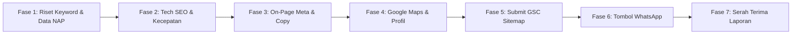

# 📋 Master Checklist SEO Proyek Klien — LADI (Layanan Digital)

Dokumen ini adalah **panduan kerja standar (Standard Operating Procedure)** yang digunakan tim LADI setiap kali membangun atau mengoptimasi website klien (UMKM, klinik, toko, kontraktor, jasa profesional). 

Gunakan checklist ini dari tahap persiapan hingga serah terima laporan untuk memastikan website klien **langsung terindeks cepat, muncul di pencarian lokal Google, dan menghasilkan lead WhatsApp nyata**.

---

## 📑 Daftar Fase Pengerjaan
1. [Fase 1: Persiapan & Riset Kata Kunci Klien](#fase-1-persiapan--riset-kata-kunci-klien)
2. [Fase 2: Technical SEO (Fondasi Kecepatan & Sistem)](#fase-2-technical-seo-fondasi-kecepatan--sistem)
3. [Fase 3: On-Page SEO (Struktur Konten & Halaman)](#fase-3-on-page-seo-struktur-konten--halaman)
4. [Fase 4: Local SEO & Google Business Profile (Peta)](#fase-4-local-seo--google-business-profile-peta)
5. [Fase 5: Google Search Console, Analytics & Indexing](#fase-5-google-search-console-analytics--indexing)
6. [Fase 6: Optimasi Konversi WhatsApp (Lead Capture)](#fase-6-optimasi-konversi-whatsapp-lead-capture)
7. [Fase 7: Serah Terima & Laporan Dampak ke Klien](#fase-7-serah-terima--laporan-dampak-ke-klien)

---

## FASE 1: Persiapan & Riset Kata Kunci Klien

Sebelum mulai menulis kode atau mendesain, tentukan target pasar klien:

- [ ] **1. Identifikasi 1 Kata Kunci Utama (Primary Keyword):**
  - Pola: `[Layanan Klien] + [Kota/Wilayah]`
  *Contoh:* `bengkel motor panggilan bogor`, `katering harian kantor jakarta selatan`, `klinik gigi depok`.
- [ ] **2. Kumpulkan 3–5 Kata Kunci Turunan (Secondary / Long-tail):**
  - Variasi pencarian harga/masalah: `biaya tambal gigi depok`, `paket nasi kotak murah bogor`.
- [ ] **3. Data Entitas Klien (Wajib 100% Konsisten):**
  - **Nama Bisnis Resmi:** (Contoh: *Katering Sari Rasa Ibu Hj. Nunung*)
  - **Alamat Lengkap:** (Jalan, RT/RW, Kelurahan, Kecamatan, Kota, Kode Pos)
  - **Nomor Telepon/WhatsApp:** (Format internasional: `+628...`)
  - **Jam Buka-Tutup:** (Senin–Minggu atau Senin–Jumat)

---

## FASE 2: Technical SEO (Fondasi Kecepatan & Sistem)

Fondasi teknis agar Googlebot menyukai website klien:

- [ ] **1. Keamanan SSL (HTTPS):**
  - Gembok hijau aktif. URL non-SSL (`http://`) wajib otomatis dialihkan (*301 redirect*) ke `https://`.
- [ ] **2. Redirect Domain Canonical:**
  - Pilih satu versi: `https://domain.com` atau `https://www.domain.com`. Versi satunya harus otomatis me-redirect agar tidak dianggap konten ganda (*duplicate content*).
- [ ] **3. Kecepatan Mobile (Core Web Vitals):**
  - Uji di [Google PageSpeed Insights](https://pagespeed.web.dev/): Skor Mobile minimal **85+**, Desktop **95+**.
  - Kompres semua gambar ke format **WebP** di bawah 150 KB.
  - Aktifkan *lazy loading* untuk gambar di luar layar pertama.
- [ ] **4. Peta Situs Otomatis (`/sitemap.xml`):**
  - Pastikan rute sitemap dinamis (`app/sitemap.ts`) aktif dan memuat seluruh halaman statis, layanan, dan artikel blog.
- [ ] **5. File Robot Mesin Pencari (`/robots.txt`):**
  - Membuka akses untuk semua bot pencari (`Allow: /`), dan mengecualikan area privat (`Disallow: /admin/`, `Disallow: /api/`).
  - Menautkan alamat sitemap di baris paling bawah.
- [ ] **6. Schema.org Structured Data (JSON-LD):**
  - **LocalBusiness / ProfessionalService:** Berisi nama bisnis, alamat, koordinat peta (*geo*), rentang harga (*priceRange*), dan nomor kontak.
  - **WebSite & Organization:** Nama brand dan tautan media sosial.
  - **BlogPosting:** Untuk setiap artikel artikel klien.

---

## FASE 3: On-Page SEO (Struktur Konten & Halaman)

Optimasi kata kunci di setiap halaman website klien:

- [ ] **1. Judul Halaman (Meta Title):**
  - Format Beranda: `[Layanan Utama] [Kota] — [Nama Brand] | [Keunggulan/USP]`
  *Contoh:* `Bengkel Motor Panggilan Bogor — Bengkel Budi Jaya | Montir Siaga 24 Jam`
  - Panjang: 50 – 60 karakter.
- [ ] **2. Deskripsi Halaman (Meta Description):**
  - Format: `[Solusi Masalah] + [Target Wilayah] + [Panggilan Bertindak/CTA]`
  *Contoh:* `Cari bengkel motor panggilan di Bogor? Teknisi berpengalaman siap datang ke lokasi Anda. Servis cepat, harga transparan, dan garansi. Hubungi via WA sekarang!`
  - Panjang: 135 – 155 karakter.
- [ ] **3. Hirarki Heading yang Benar:**
  - `H1` (Hanya 1 per halaman): Mengandung target keyword utama di awal.
  - `H2`: Sub-layanan, keunggulan, daftar paket, testimoni.
  - `H3`: Rincian fitur atau pertanyaan FAQ.
- [ ] **4. Teks Alt Gambar (Image Alt Text):**
  - Semua gambar produk/layanan memiliki teks alt deskriptif.  
    *(Bagus: `alt="proses servis motor matic di bogor"` | Buruk: `alt="foto1"` atau `alt=""`)*
- [ ] **5. Tautan Internal Kontekstual:**
  - Hubungkan halaman beranda ke halaman layanan dan studi kasus portofolio.
- [ ] **6. Informasi Legal & Kontak di Footer:**
  - Tampilkan alamat fisik lengkap, email, nomor WhatsApp, dan tautan media sosial resmi klien.

---

## FASE 4: Local SEO & Google Business Profile (Peta)

Faktor penentu nomor satu agar klien muncul di pencarian lokal *"di sekitar saya"* (*near me*):

- [ ] **1. Pendaftaran / Klaim Google Business Profile:**
  - Daftarkan akun di [Google Business Profile](https://business.google.com).
- [ ] **2. Penamaan Profil yang Tepat:**
  - Format: `[Nama Bisnis Klien] - [Layanan Utama] [Kota]`  
  *Contoh:* `Katering Sari Rasa - Jasa Katering & Nasi Kotak Bogor`
- [ ] **3. Penentuan Titik Koordinat Peta Presisi:**
  - Geser pin peta tepat di atas gerbang/pintu masuk toko fisik klien.
- [ ] **4. Pemilihan Kategori Bisnis:**
  - **Primary Category:** Pilih kategori paling spesifik (contoh: *Katering*, bukan sekadar *Restoran*).
  - **Secondary Categories:** Tambahkan 2–3 kategori relevan.
- [ ] **5. Tautkan Website Resmi:**
  - Masukkan URL website yang baru dibuat (gunakan HTTPS).
- [ ] **6. Unggah Foto Profil Lengkap:**
  - Foto plang nama toko, tampak depan dari jalan raya, foto ruangan kerja/etalase, dan foto tim.
- [ ] **7. Strategi 5 Ulasan Perdana:**
  - Berikan panduan dan tautan pintas (*review shortlink*) agar klien bisa meminta ulasan bintang 5 pertama dari pelanggan setia mereka.

---

## FASE 5: Google Search Console, Analytics & Indexing

Menghubungkan website klien langsung ke radar Google:

- [ ] **1. Verifikasi Google Search Console (GSC):**
  - Tambahkan properti domain di [Google Search Console](https://search.google.com/search-console).
  - Verifikasi menggunakan DNS TXT record atau meta tag HTML.
- [ ] **2. Submit Peta Situs (`sitemap.xml`):**
  - Masuk ke menu **Sitemaps** di GSC, masukkan URL `sitemap.xml`, lalu klik **Kirim / Submit**.
  - Pastikan statusnya berubah menjadi **Sukses (Success)** warna hijau.
- [ ] **3. Request Indexing Manual (Halaman Prioritas Saja):**
  - Gunakan fitur **URL Inspection** untuk me-request index 2–3 halaman penting:
    - [ ] Halaman Beranda (`/`)
    - [ ] Halaman Layanan Utama (`/services` atau paket utama)
- [ ] **4. Setup Google Analytics 4 (GA4):**
  - Pasang tracking ID GA4 untuk merekam jumlah pengunjung, asal kota, dan perangkat yang digunakan.

---

## FASE 6: Optimasi Konversi WhatsApp (Lead Capture)

SEO yang berhasil adalah SEO yang menghasilkan transaksi nyata bagi klien:

- [ ] **1. Tombol WhatsApp Mengambang (Floating Button):**
  - Selalu tampak di sudut kanan/kiri bawah layar HP dan desktop.
- [ ] **2. Template Pesan Otomatis (Pre-filled Text):**
  - Teks pembuka otomatis ramah pembeli:  
    *`"Halo [Nama Bisnis], saya melihat layanan [Nama Layanan] di website resmi Anda. Saya ingin konsultasi/tanya harga..."`*
- [ ] **3. Waktu Respon Cepat (Quick Response):**
  - Bantu klien mengatur *Greeting Message* (Pesan Salam) di WhatsApp Bisnis mereka.

---

## FASE 7: Serah Terima & Laporan Dampak ke Klien

Tunjukkan profesionalitas LADI dengan laporan transparan yang membuat klien puas dan merekomendasikan jasa Anda ke teman-temannya:

- [ ] **1. Screenshot Hasil Uji Kecepatan Google PageSpeed:**
  - Lampirkan bukti skor hijau 90+ di HP.
- [ ] **2. Bukti Terdaftar di Google Search Console:**
  - Tunjukkan tangkapan layar bahwa sitemap sudah berstatus sukses di Google.
- [ ] **3. Bukti Titik Peta Google Maps Aktif:**
  - Tautan langsung Google Maps lokasi usaha klien.
- [ ] **4. Lembar Panduan Singkat untuk Klien:**
  - Cara membalas ulasan Google.
  - Cara membagikan link website ke pelanggan baru.
  - Cara mengecek kontak yang masuk dari website.

---

## 💡 Ringkasan Alur Kerja Cepat (Cheat Sheet)

