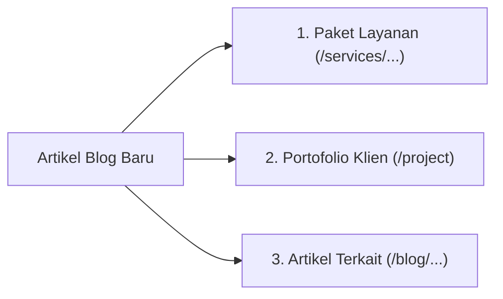

# 🚀 SOP & Panduan Lengkap Penulisan Konten Blog SEO — LADI (Layanan Digital)

Dokumen ini adalah **Standar Operasional Prosedur (SOP)** wajib bagi penulis, admin, dan tim pemasaran LADI dalam memproduksi artikel blog. Tujuannya adalah memastikan setiap artikel yang dipublikasikan mampu **menembus peringkat teratas Google (Halaman 1 / Top 3)**, memenangkan kotak *Featured Snippets*, serta mengonversi pembaca menjadi calon klien via WhatsApp.

---

## 📑 Daftar Isi
1. [Target & Prinsip Algoritma Google 2026](#1-target--prinsip-algoritma-google-2026)
2. [Anatomi Standar Emas Artikel Peringkat #1](#2-anatomi-standar-emas-artikel-peringkat-1)
3. [Formula Judul (H1) Berdaya Klik Tinggi (CTR Magnet)](#3-formula-judul-h1-berdaya-klik-tinggi-ctr-magnet)
4. [Paragraf Pembuka: Metode BLUF (100 Kata Pertama)](#4-paragraf-pembuka-metode-bluf-100-kata-pertama)
5. [Struktur Badan Konten & Tipografi](#5-struktur-badan-konten--tipografi)
6. [Aturan "Segitiga Emas" Internal Linking (Wajib 3 Link)](#6-aturan-segitiga-emas-internal-linking-wajib-3-link)
7. [Seksi FAQ Magnet Google Featured Snippets](#7-seksi-faq-magnet-google-featured-snippets)
8. [Call-to-Action (CTA) Konversi WhatsApp](#8-call-to-action-cta-konversi-whatsapp)
9. [Template Siap Pakai (Tinggal Salin)](#9-template-siap-pakai-tinggal-salin)
10. [Checklist 10 Poin Sebelum Klik "Publish"](#10-checklist-10-poin-sebelum-klik-publish)

---

## 1. Target & Prinsip Algoritma Google 2026

Google memprioritaskan website yang memiliki **E-E-A-T (*Experience, Expertise, Authoritativeness, Trustworthiness*)**:
* **Experience (Pengalaman Nyata):** Wajib mencantumkan contoh atau studi kasus riil proyek yang pernah dikerjakan LADI.
* **Topical Authority (Otoritas Topik):** Semua artikel berpusat pada topik transformasi digital UMKM, website bisnis, SEO lokal Google Maps, dan efisiensi WhatsApp.
* **Search Intent:** Menjawab masalah pencari secara langsung tanpa bertele-tele (*no fluff / filler content*).

---

## 2. Anatomi Standar Emas Artikel Peringkat #1

```
┌──────────────────────────────────────────────────────────────┐
│ 1. JUDUL (H1): Target Keyword di Depan + Angka + Manfaat      │
├──────────────────────────────────────────────────────────────┤
│ 2. PARAGRAF PEMBUKA (BLUF): Jawab masalah inti dalam 100 kata│
├──────────────────────────────────────────────────────────────┤
│ 3. H2 PEMBAHASAN UTAMA: Penjelasan konsep + Tabel/List ringkas│
│    🔗 Internal Link 1: Tautkan ke Layanan (/services/...)    │
├──────────────────────────────────────────────────────────────┤
│ 4. H2 BUKTI RIIL & STUDI KASUS: Bukti E-E-A-T lapangan       │
│    🔗 Internal Link 2: Tautkan ke Portofolio (/project)      │
├──────────────────────────────────────────────────────────────┤
│ 5. H2 TIPS PRAKTIS / CARA MENERAPKAN: Langkah terperinci (H3)│
│    🔗 Internal Link 3: Tautkan ke Artikel Blog Terkait       │
├──────────────────────────────────────────────────────────────┤
│ 6. H2 PERTANYAAN UMUM (FAQ): 2–3 Q&A pemicu Featured Snippet │
├──────────────────────────────────────────────────────────────┤
│ 7. CALL TO ACTION (CTA): Kotak konsultasi WhatsApp gratis    │
└──────────────────────────────────────────────────────────────┘
```

---

## 3. Formula Judul (H1) Berdaya Klik Tinggi (CTR Magnet)

Judul harus memuat target kata kunci di bagian paling awal dan memicu rasa ingin tahu atau solusi instan.

### Rumus Judul:
> **`[Angka] + [Target Keyword] + [Solusi / Manfaat Riil] + [Tahun / Dalam Kurung]`**

### Contoh Komparasi:
| ❌ Judul Biasa (Sulit Bersaing) | ✅ Judul Pemenang SEO (Klik Tinggi) |
| :--- | :--- |
| *Tips Bikin Website UMKM* | **7 Cara Membuat Website UMKM Profesional (Hemat Biaya & Ramah HP)** |
| *Kenapa Butuh Google Maps* | **Panduan Cara Daftar Google Maps Usaha agar Cepat Terverifikasi (2026)** |
| *Jualan di WhatsApp* | **Cara Mengubah WhatsApp Bisnis Menjadi Mesin Penjualan Otomatis** |
| *Berapa Biaya Website* | **Berapa Biaya Pembuatan Website UMKM di 2026? Rincian Lengkap & Tips Hemat** |

> **Catatan Teknis:** Panjang judul maksimal **55–65 karakter** agar tidak terpotong elipsis (`...`) di layar pencarian ponsel.

---

## 4. Paragraf Pembuka: Metode BLUF (100 Kata Pertama)

Gunakan metode **BLUF (*Bottom Line Up Front*)**: langsung berikan inti jawaban di paragraf pertama.

1. **Kalimat 1–2 (Masalah):** Sentuh kendala nyata calon pembeli.  
   *(Contoh: "Banyak pemilik toko heran mengapa usaha tetangga yang kualitasnya biasa saja justru selalu ramai dicari orang di Google.")*
2. **Kalimat 3–4 (Kata Kunci & Jawaban Inti):** Masukkan target keyword secara natural di sini.  
   *(Contoh: "Kuncinya ada pada **cara mendaftarkan usaha ke Google Maps** dan kepemilikan website resmi yang cepat dibuka.")*
3. **Kalimat 5 (Janji Artikel):** Sampaikan apa yang akan didapatkan pembaca di akhir panduan ini.

---

## 5. Struktur Badan Konten & Tipografi

* **Panjang Paragraf:** Maksimal **2–3 kalimat per paragraf**. Jangan pernah membuat satu paragraf setebal 6 baris karena memicu *bounce rate* tinggi pada pengguna HP.
* **Hirarki Heading:**
  * Gunakan `H2` untuk sub-bab topik utama.
  * Gunakan `H3` untuk rincian langkah atau poin di bawah `H2`.
  * *Haram melompati heading (misal langsung dari H1 ke H3).*
* **Gunakan Tabel atau Bullet Points:**  
  Algoritma Google menyukai format tabel dan list untuk ditarik ke peringkat 0 (*Featured Snippets*).
* **Format Penekanan:** Cetak tebal (**bold**) frasa penting agar pembaca yang melakukan *skimming* langsung menangkap poin utama dalam 5 detik.

---

## 6. Aturan "Segitiga Emas" Internal Linking (Wajib 3 Link)

Setiap artikel **wajib** memiliki minimal 3 jenis tautan internal berikut:



### 1. Link ke Layanan LADI (`/services/...`)
Arahkan pembaca ke paket solusi yang sesuai:
* `/services/paket-exist` (Untuk bisnis baru, landing page 1 halaman, titik Google Maps)
* `/services/paket-rise` (Untuk website multi-halaman lengkap + panel admin + SEO)
* `/services/paket-run` (Untuk sistem katalog + transaksi QRIS otomatis)

### 2. Link ke Portofolio Studi Kasus (`/project`)
Cantumkan hasil nyata dari klien LADI sebagai pembuktian E-E-A-T:
* **Bengkel Motor Budi Jaya:** Kenaikan panggilan darurat servis +340% via Google Maps.
* **Katering Sari Rasa Ibu Hj. Nunung:** Peningkatan omzet pesanan kantor korporat +180%.
* **Klinik Gigi drg. Sejahtera:** Sistem booking online bebas antrean ruang tunggu.
* **Pusat Oleh-Oleh Khas Bogor Bu Ratna:** Lonjakan penjualan wisatawan luar kota +210%.

### 3. Link ke Artikel Blog Relevan Lainnya (`/blog/...`)
Bangun jaringan topik (*topic cluster*) agar pembaca dan Googlebot menjelajahi artikel lain di website LADI.

> [!CAUTION]
> **Larangan Teks Tautan:** Hindari kata *"klik di sini"*, *"link ini"*, atau *"baca ini"*. Buat teks tautan yang deskriptif (misal: *"[studi kasus digitalisasi UMKM](/project)"* atau *"[Paket EXIST Website Resmi](/services/paket-exist)"*).

---

## 7. Seksi FAQ Magnet Google Featured Snippets

Sebelum penutup artikel, selalu sediakan 2–3 pertanyaan umum menggunakan `H3`:

```html
<h2>Pertanyaan yang Sering Diajukan (FAQ)</h2>

<h3>Berapa lama proses pembuatan website di Ladi?</h3>
<p>Proses pengerjaan website di Ladi memakan waktu antara 5 hingga 7 hari kerja untuk Paket EXIST, dan 10 hingga 14 hari kerja untuk Paket RISE lengkap.</p>

<h3>Apakah saya perlu paham coding untuk mengelola website?</h3>
<p>Tidak perlu. Semua website yang kami bangun dilengkapi panel admin yang sangat mudah digunakan di smartphone atau laptop layaknya mengetik status media sosial.</p>
```

---

## 8. Call-to-Action (CTA) Konversi WhatsApp

Setiap artikel harus diakhiri dengan ajakan bertindak yang jelas. Gunakan format pesan WhatsApp yang menyertakan judul artikel agar admin tahu asal sumber prospek:

```html
<div class="callout-box">
  <h4>💡 Butuh Bantuan Mendigitalisasi Usaha Anda?</h4>
  <p>Jangan biarkan waktu Anda habis untuk urusan teknis server dan coding. Tim ahli Ladi siap membantu bisnis Anda hadir resmi di Google Maps dan memiliki website berkecepatan tinggi.</p>
  <p><a href="https://wa.me/6282112477119?text=Halo+Ladi%2C+saya+baru+baca+artikel+di+website+dan+mau+konsultasi.">Konsultasi Gratis via WhatsApp Sekarang →</a></p>
</div>
```

---

## 9. Template Siap Pakai (Tinggal Salin)

Gunakan kerangka kode HTML berikut saat membuat artikel baru di form admin:

```html
<p>[Kalimat 1-2: Sentuh masalah utama pembaca]. Jawabannya terletak pada <strong>[Target Keyword Utama]</strong> yang tepat dan terukur. Dalam panduan ini, kita akan membedah langkah praktisnya agar bisnis Anda segera menghasilkan hasil nyata.</p>

<h2>Mengapa [Topik Utama] Sangat Krusial untuk Bisnis Anda?</h2>
<p>[Jelaskan pentingnya topik ini dengan data atau fakta perilaku konsumen modern].</p>
<ul>
  <li><strong>Poin Keuntungan 1:</strong> [Penjelasan singkat].</li>
  <li><strong>Poin Keuntungan 2:</strong> [Penjelasan singkat].</li>
  <li><strong>Poin Keuntungan 3:</strong> [Penjelasan singkat].</li>
</ul>

<h2>Langkah Praktis [Topik Utama]</h2>
<h3>1. [Langkah Pertama]</h3>
<p>[Penjelasan detail langkah 1]. Anda bisa mempelajari layanan pendukung kami di <a href="/services/paket-exist">Paket EXIST Ladi</a>.</p>

<h3>2. [Langkah Kedua]</h3>
<p>[Penjelasan detail langkah 2].</p>

<div class="callout-box">
  <h4>🎯 Studi Kasus Riil</h4>
  <p>Lihat bagaimana strategi ini berhasil diterapkan pada mitra kami, <strong>[Nama Klien]</strong>, yang berhasil mencatatkan peningkatan hasil signifikan. <a href="/project">Baca studi kasus lengkapnya di sini →</a></p>
</div>

<h2>Pertanyaan yang Sering Diajukan (FAQ)</h2>
<h3>[Pertanyaan Populer 1]?</h3>
<p>[Jawaban ringkas 2-3 kalimat].</p>

<h3>[Pertanyaan Populer 2]?</h3>
<p>[Jawaban ringkas 2-3 kalimat].</p>

<div class="callout-box">
  <h4>🚀 Siap Membawa Usaha Anda ke Level Berikutnya?</h4>
  <p>Tim Ladi siap mendampingi perjalanan digital bisnis Anda dari awal hingga menghasilkan pelanggan nyata.</p>
  <p><a href="https://wa.me/6282112477119?text=Halo+Ladi%2C+saya+tertarik+konsultasi+setelah+membaca+panduan+di+website.">Konsultasi Langsung via WhatsApp →</a></p>
</div>
```

---

## 10. Checklist 10 Poin Sebelum Klik "Publish"

Sebelum menekan tombol terbitkan di admin panel, pastikan seluruh kotak di bawah ini tercentang:

- [ ] **1. Target Keyword Utama Ditetapkan:** Tahu persis 1 kata kunci pencarian yang ingin dimenangkan.
- [ ] **2. Keyword di Judul (H1):** Target keyword berada di awal judul artikel.
- [ ] **3. Keyword di Paragraf 1:** Muncul secara alami dalam 100 kata pertama.
- [ ] **4. Slug URL Bersih:** Singkat, menggunakan huruf kecil dan strip (contoh: `cara-daftar-google-maps`).
- [ ] **5. Paragraf Ringkas:** Tidak ada paragraf lebih dari 3 kalimat.
- [ ] **6. Ada Elemen Pemindaian Cepat:** Memiliki minimal 1 tabel, bullet points, atau kotak sorotan (*callout box*).
- [ ] **7. Link ke Layanan (`/services/...`):** Minimal 1 link mengarah ke paket LADI.
- [ ] **8. Link ke Portofolio (`/project`):** Minimal 1 link mengarah ke studi kasus riil klien LADI.
- [ ] **9. Link ke Artikel Lain (`/blog/...`):** Minimal 1 link ke artikel terkait di website LADI.
- [ ] **10. Tombol CTA WhatsApp Terpasang:** Link WhatsApp aktif dan siap menerima pesan dari calon klien.
